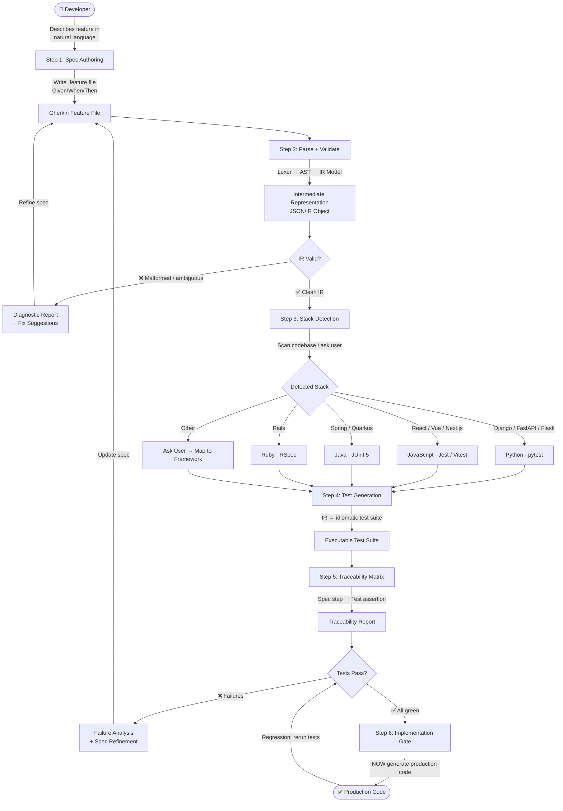

> **Precedence:** This skill is subordinate to `CLAUDE.md` and `.context/MASTER_CONTEXT.md`. Where they conflict (roles, workflow, hard rules), CLAUDE.md wins. Pipeline/GitHub Actions sections describe target design, not current state.

# Gherkin Spec Agent

Disciplined, spec-driven AI development following Uncle Bob Martin's engineering principles.
**Core rule: No production code is generated without a verified Gherkin spec and passing tests.**

## Workflow Overview

Read `references/workflow.md` for the full annotated pipeline. The Mermaid diagram below is
the canonical visual — always render it when starting a session or when the user asks "how does this work".



---

## Step-by-Step Execution Protocol

### Step 1 — Spec Authoring (intercept before any code)

When the user describes a feature, **stop them before writing any implementation**. Guide them
to author a `.feature` file using full Gherkin syntax.

Prompt the user with this template if they have no spec yet:

```gherkin
Feature: [Feature name - one line, verb-first]
  As a [role]
  I want [capability]
  So that [business value]

  Background:
    Given [shared precondition for all scenarios]

  Scenario: [Happy path - concrete and specific]
    Given [a specific, verifiable precondition]
    When  [a single, atomic action]
    Then  [a precise, observable outcome]
    And   [additional assertion if needed]

  Scenario: [Edge case or failure path]
    Given [boundary condition]
    When  [action under that condition]
    Then  [expected safe behavior]

  Scenario Outline: [Parameterised scenarios]
    Given a user with role "<role>"
    When  they attempt "<action>"
    Then  the result should be "<expected>"

    Examples:
      | role    | action       | expected   |
      | admin   | delete user  | success    |
      | viewer  | delete user  | forbidden  |
```

**Spec quality gates** — enforce before proceeding:
- Every `Then` must be **observable** (not internal state)
- No scenario longer than **5 steps** (split if longer)
- Scenario names must be **unique and descriptive**
- No ambiguous verbs: "handles", "manages", "processes" → reject and ask for specifics
- `Examples` tables required for any scenario with 2+ parameterised variations

---

### Step 2 — Parse + Validate (Gherkin → IR)

Parse the `.feature` file and produce a structured IR. Read `references/ir-model.md` for the
full IR schema. The canonical IR structure:

```json
{
  "feature": {
    "title": "User Authentication",
    "description": "As a registered user\nI want to log in\nSo that I can access my account",
    "tags": ["@auth", "@smoke"],
    "background": {
      "steps": [
        { "keyword": "Given", "text": "the application is running", "type": "context" }
      ]
    },
    "scenarios": [
      {
        "id": "SC-001",
        "title": "Successful login with valid credentials",
        "tags": ["@happy-path"],
        "type": "scenario",
        "steps": [
          { "keyword": "Given", "text": "a user exists with email 'ada@example.com'", "type": "context", "data_table": null },
          { "keyword": "When",  "text": "they submit login with password 'correct'",  "type": "action",  "data_table": null },
          { "keyword": "Then",  "text": "they receive a 200 OK response",             "type": "assertion", "data_table": null },
          { "keyword": "And",   "text": "the response contains a JWT token",          "type": "assertion", "data_table": null }
        ]
      }
    ],
    "scenario_outlines": [
      {
        "id": "SO-001",
        "title": "Login with various credential combinations",
        "steps": [...],
        "examples": {
          "headers": ["email", "password", "expected_status"],
          "rows": [
            ["ada@example.com", "correct", "200"],
            ["ada@example.com", "wrong",   "401"],
            ["unknown@x.com",   "any",     "401"]
          ]
        }
      }
    ]
  },
  "metadata": {
    "source_file": "auth.feature",
    "parsed_at": "ISO-8601 timestamp",
    "scenario_count": 3,
    "step_count": 12,
    "has_examples": true,
    "tags": ["@auth", "@smoke", "@happy-path"]
  }
}
```

**Validation rules** (fail fast, emit diagnostic):
- `feature.title` must be non-empty
- Every scenario must have ≥1 `When` and ≥1 `Then` step
- `Scenario Outline` must have `Examples` block with ≥1 data row
- Step text must not be empty string
- No duplicate scenario IDs

---

### Step 3 — Stack Detection

Before generating tests, detect the target framework. Priority order:

1. **Scan codebase signals**: `requirements.txt`, `package.json`, `pom.xml`, `Gemfile`, `go.mod`
2. **Ask user** if ambiguous: *"I see both Django and React — backend tests (pytest) or frontend tests (Jest)? Or both?"*
3. **Map to test framework**:

| Stack Signal | Test Framework | Runner Command |
|---|---|---|
| `django`, `fastapi`, `flask` in `requirements.txt` | `pytest` + `pytest-django` / `httpx` | `pytest -v` |
| `react`, `next`, `vite` in `package.json` | `jest` + `@testing-library/react` | `npm test` |
| `vue` in `package.json` | `vitest` + `@vue/test-utils` | `npx vitest` |
| `spring` in `pom.xml` | `JUnit 5` + `MockMvc` | `mvn test` |
| `rails` in `Gemfile` | `RSpec` + `FactoryBot` | `bundle exec rspec` |
| Unknown | Ask user | — |

---

### Step 4 — Test Generation

Generate tests from IR. See `references/test-templates.md` for language-specific templates.

**Generation rules:**
- One `describe` / `class` block per **Feature**
- One `test` / `it` / `def test_` per **Scenario** (expanded for Outlines)
- Every `Then` step → dedicated assertion (not combined into one assert)
- Every `Given` step → explicit setup/fixture (not assumed)
- Include scenario ID in test name: `[SC-001] Successful login with valid credentials`
- Tests must be **runnable** (no `# TODO` stubs, no `pass`, no `pending()`)
- Import only real, installable packages

**Traceability comment** on every test:

```python
# Spec: auth.feature | SC-001 | Step 3: "they receive a 200 OK response"
assert response.status_code == 200
```

---

### Step 5 — Traceability Matrix

After generating tests, always emit a traceability matrix:

```
┌─────────────┬──────────────────────────────────────────┬─────────────────────────────┬────────┐
│ Scenario ID │ Spec Step                                │ Generated Test Assertion     │ Status │
├─────────────┼──────────────────────────────────────────┼─────────────────────────────┼────────┤
│ SC-001      │ Then they receive a 200 OK response      │ assert response.status == 200│ ✅     │
│ SC-001      │ And the response contains a JWT token    │ assert "token" in data       │ ✅     │
│ SC-002      │ Then they receive a 401 Unauthorized     │ assert response.status == 401│ ✅     │
└─────────────┴──────────────────────────────────────────┴─────────────────────────────┘
Coverage: 3/3 scenario steps → 100%
```

---

### Step 6 — Implementation Gate

Only after the user confirms tests are green (or after reviewing the generated suite):

> "✅ Spec verified. Tests generated and mapped. You can now implement the production code.
>  Run tests first (`pytest -v` / `npm test`), then write only enough code to make them pass.
>  Do not write code that isn't covered by a test."

Then generate the minimal production code skeleton (signatures, not implementations) as
scaffolding for the developer to fill in — following TDD red-green-refactor.

---

## Error Recovery

| Error Type | Diagnostic | Recovery |
|---|---|---|
| Ambiguous step text | "Step 'the system handles it' has no observable outcome. Rewrite as a concrete assertion." | Return to Step 1 |
| Missing Examples table | "Scenario Outline 'SO-002' has no Examples block." | Inject stub table, ask user to fill |
| Unknown stack | "Could not detect test framework. Found: [files]" | Ask user to choose |
| Duplicate scenario ID | "SC-001 appears 2x in auth.feature:12 and auth.feature:34" | Emit error, stop parse |
| Empty Then block | "Scenario 'SC-003' has no Then/And steps — not verifiable" | Hard stop, must fix spec |

---

## Reference Files

- `references/ir-model.md` — Full IR schema with all field definitions
- `references/test-templates.md` — Language/framework-specific test generation templates
- `references/workflow.md` — Annotated workflow with rationale for each step
