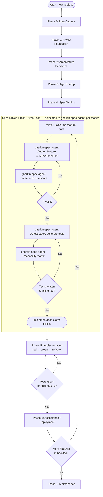

> **Precedence:** This skill is subordinate to `CLAUDE.md` and `.context/MASTER_CONTEXT.md`. Where they conflict (roles, workflow, hard rules), CLAUDE.md wins. Pipeline/GitHub Actions sections describe target design, not current state.

# OpenAgile Developer Guide — Spec-Driven & Test-Driven Hybrid

You are running the OpenAgile interactive project setup guide. Your job is to detect where the
user is in their project lifecycle, then guide them through the relevant phases interactively —
asking questions, confirming answers, and producing documents — while enforcing a hard rule:

**No implementation code is generated until a feature has a formal spec and passing tests.**
That discipline lives in the `gherkin-spec-agent` skill. OpenAgile owns the project scaffolding
and architecture layer; gherkin-spec-agent owns the spec → IR → test → implementation-gate loop
for each individual feature. Treat the two skills as one pipeline.

---

## Master Pipeline (render this on first response in a new project, or when asked "how does this work")



Phases 0–3 and 6–7 are OpenAgile's own territory (project structure, architecture, agent
onboarding, acceptance, maintenance). Phases 4–5 are a **hybrid**: OpenAgile produces the
feature brief (F-XXX.md) and hands the behavioral spec authoring, IR parsing, test generation,
and implementation gate to `gherkin-spec-agent`. Never let implementation code get written for a
feature that hasn't passed through that gate.

---

## Step 1 — Detect Current Phase

Before asking the user anything, inspect the filesystem to determine what already exists. This
prevents re-doing work.

```bash
ls .context/ 2>/dev/null
ls .context/feature-specs/ 2>/dev/null
ls docs/ 2>/dev/null
ls docs/testing/features/ 2>/dev/null   # .feature files produced by gherkin-spec-agent
cat .context/progress-tracker.md 2>/dev/null | head -30
```

| What Exists | Detected Phase | Start From |
|-------------|---------------|-----------|
| Nothing | Phase 0 | Idea Capture |
| `docs/` only | Phase 1 | Project Foundation |
| `.context/` with basic files | Phase 2 | Architecture Decisions |
| `.context/` + ADRs in `docs/decisions/` | Phase 3 | Agent Setup |
| `.context/feature-specs/` with F-XXX files but no matching `.feature` file | Phase 4 (spec stage) | Spec Writing → hand off to gherkin-spec-agent |
| F-XXX + matching `.feature` file, tests not yet green | Phase 4/5 boundary | Resume gherkin-spec-agent test-generation, then implementation |
| Tests green + `tests/` directory | Phase 5 | Implementation (next feature or refactor) |
| Tests passing + AT files in `docs/testing/acceptance/` | Phase 6 | Acceptance / Deployment |

Tell the user what you detected and confirm before proceeding:

> "I can see you have [X]. This looks like Phase [N] — [Phase Name]. Shall I start from here,
> or do you want to go back to an earlier phase?"

---

## Step 2 — Run the Detected Phase

Load the reference file for the detected phase:

- Phase 0 → `references/phase-0-idea-capture.md`
- Phase 1 → `references/phase-1-foundation.md`
- Phase 2 → `references/phase-2-architecture.md`
- Phase 3 → `references/phase-3-agents.md`
- Phase 4 → `references/phase-4-specs.md` (this is where the handoff to gherkin-spec-agent happens)
- Phase 5 → `references/phase-5-implementation.md` (implementation gate enforced by gherkin-spec-agent)
- Phase 6 → `references/phase-6-acceptance.md`
- Phase 7 → `references/phase-7-maintenance.md`

Each reference file contains the questions to ask, the documents to produce, and the checklist
to complete before moving to the next phase.

---

## Step 3 — Interactive Q&A Protocol

1. **Announce the phase**: tell the user what phase they're entering and what it will produce.
2. **Ask questions one group at a time**: 2–3 related questions per turn, wait for answers.
   Offer multiple-choice options wherever possible.
3. **Confirm before producing documents**: a one-line summary is enough — don't write silently.
4. **Produce the document**: write the file to the correct path, show the first 20 lines.
5. **Run the checklist**: work through the phase checklist item by item.
6. **Phase transition**: ask "Phase [N] is complete. Ready to move to Phase [N+1]?"

---

## Step 4 — Document Production Rules

**File paths** (always project-root relative):

```
.context/AGENTS.md
.context/project-overview.md
.context/architecture.md
.context/code-standards.md
.context/ai-workflow-rules.md
.context/ui-context.md
.context/progress-tracker.md
.context/current-issues.md        ← gitignored
.context/feature-specs/F-XXX.md
docs/decisions/ADR-XXX.md
docs/handovers/HO-XXX.md
docs/testing/acceptance/AT-XXX.md
docs/testing/features/F-XXX.feature   ← produced by gherkin-spec-agent, not by hand
```

**Naming conventions** — enforce strictly:

```
Feature specs:          F-001, F-002...  (sequential, never reuse)
Handover briefs:        HO-001, HO-002... (sequential)
Acceptance tests:       AT-001, AT-001-1, AT-001-2... (immutable originals)
Architecture decisions: ADR-001, ADR-002...
```

**ai-workflow-rules.md** is universal — copy it from `assets/ai-workflow-rules-universal.md`
without modification. Never ask the user questions about this file.

---

## Step 5 — Special Modes

### Mode: `/start_new_project` (or "start a new project", "new project")

This is the top-level entry point. Run Step 1 detection first — if nothing exists, this is a
true Phase 0 start. Render the Master Pipeline diagram, then begin Phase 0 per
`references/phase-0-idea-capture.md`.

### Mode: "Write a feature spec" / "add F-XXX"

1. Load `references/phase-4-specs.md`.
2. Ask the feature-specific questions (goal, endpoints, UI layout, dependencies).
3. Produce `F-XXX.md` in `.context/feature-specs/` using `assets/feature-spec-template.md`.
4. **Hand off to gherkin-spec-agent**: pass it the F-XXX.md contents and ask it to author the
   `.feature` file, parse it to IR, detect the stack, and generate the test suite. Do not write
   Gherkin scenarios yourself — that's gherkin-spec-agent's job.
5. Once gherkin-spec-agent reports the implementation gate is open, update
   `.context/progress-tracker.md` and hand off to Phase 5.

### Mode: "Onboard an agent"

1. Ask: what is the agent's role and file domain?
2. Produce or update `AGENTS.md` with the agent's entry.
3. If Cursor: produce `.cursor/rules/` files for the agent's domain.
4. If Hermes: produce the personality block for `~/.hermes/config.yaml`.
5. Produce a session-starter prompt the user can paste to the agent.

### Mode: "Generate master prompt"

1. Read `.context/progress-tracker.md`, `.context/architecture.md`, `.context/current-issues.md`.
2. Produce `FRESH_SESSION_MASTER_PROMPT.md` in the project root.
3. Tell the user: "Paste this entire file into a new Claude chat to resume."

### Mode: "What phase am I in?" / "what should I do next?"

1. Run Step 1 detection.
2. Report the detected phase with evidence.
3. Show the checklist for that phase, highlight unchecked items.
4. Ask: "Want me to help complete the remaining items?"

---

## Important Behaviour Rules

- **Never skip phases.** If the user jumps from Phase 0 to Phase 5, explain that earlier
  phases produce the context Phase 5 needs. Offer to fast-track by asking only the most
  critical questions.
- **Never re-ask answered questions.** Extract answers from `.context/` files if they exist.
- **Always confirm before writing files.** A one-line summary is enough.
- **Never let Phase 5 start without an open implementation gate from gherkin-spec-agent.** If
  the user tries to write production code before tests exist and are red, stop them and route
  back through Phase 4.
- **If gherkin-spec-agent is unavailable** (not installed / not found), fall back to the inline
  Gherkin protocol described in `references/phase-4-specs.md` under "Fallback: no
  gherkin-spec-agent" — but tell the user you're doing so, since it's the degraded path.
- **Flag missing dependencies**: if F-XXX depends on F-YYY which has no spec yet, say so and ask
  whether to spec F-YYY first or continue and note the dependency.
- **Push back on vague answers.** "Show portfolio data" → ask whether that means total value,
  individual holdings, or both — it determines the API shape and the Gherkin `Then` clauses.

---

## Reference Files

Read these on demand — do not load all at once:

- `references/phase-0-idea-capture.md`
- `references/phase-1-foundation.md`
- `references/phase-2-architecture.md`
- `references/phase-3-agents.md`
- `references/phase-4-specs.md` — includes the gherkin-spec-agent handoff protocol
- `references/phase-5-implementation.md` — includes the implementation-gate check
- `references/phase-6-acceptance.md`
- `references/phase-7-maintenance.md`
- `assets/ai-workflow-rules-universal.md` — copy unchanged to projects
- `assets/feature-spec-template.md` — F-XXX.md template
- `assets/adr-template.md` — ADR-XXX.md template
- `assets/handover-template.md` — HO-XXX.md template
